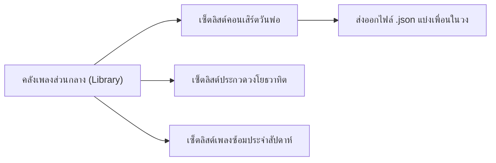

# 📖 คู่มือการใช้งาน MaestroScroll ฉบับสมบูรณ์ (สำหรับนักเรียน & สมาชิกวงดนตรี)

> **MaestroScroll v1.3.3** — พัฒนาโดย **@mamazaki**  
> เว็บแอปพลิเคชันสำหรับเปิดอ่าน แยกพาร์ท ซ้อมดนตรี เขียนโน้ต และขึ้นแสดงสดบนเวที  
> เข้าใช้งานได้ทันทีผ่านเบราว์เซอร์: **[https://mamazaki.github.io/orchestra-score/](https://mamazaki.github.io/orchestra-score/)**

---

## 📑 สารบัญ
1. [ภาพรวมของระบบและจุดเด่น](#1-ภาพรวมของระบบและจุดเด่น)
2. [วิธีเข้าใช้งานและติดตั้งลงบนสมาร์ตโฟน / แท็บเล็ต (PWA)](#2-วิธีเข้าใช้งานและติดตั้งลงบนสมาร์ตโฟน--แท็บเล็ต-pwa)
3. [โมดูลที่ 1: สกอร์วง & แยกพาร์ท (Orchestra & Band Score Viewer)](#3-โมดูลที่-1-สกอร์วง--แยกพาร์ท-orchestra--band-score-viewer)
4. [โมดูลที่ 2: สตูดิโอเขียนโน้ตเพลง (Composer Studio - ABC Notation)](#4-โมดูลที่-2-สตูดิโอเขียนโน้ตเพลง-composer-studio---abc-notation)
5. [โมดูลที่ 3: โหมดเวที & เลื่อนโน้ตอัตโนมัติ (Stage Mode & Auto-Scroll)](#5-โมดูลที่-3-โหมดเวที--เลื่อนโน้ตอัตโนมัติ-stage-mode--auto-scroll)
6. [โมดูลที่ 4: คลังเพลง & เซ็ตลิสต์การแสดง (Library & Setlists)](#6-โมดูลที่-4-คลังเพลง--เซ็ตลิสต์การแสดง-library--setlists)
7. [โมดูลที่ 5: เครื่องมือช่วยซ้อม (Metronome & Presets Tuner)](#7-โมดูลที่-5-เครื่องมือช่วยซ้อม-metronome--presets-tuner)
8. [โหมดถนอมสายตา & โหมดอ่านโน้ตเต็มจอ 100% (Focus Reader)](#8-โหมดถนอมสายตา--โหมดอ่านโน้ตเต็มจอ-100-focus-reader)
9. [การต่อใช้งานแป้นเหยียบเปลี่ยนหน้าไร้สาย (Bluetooth Page Turner Pedal)](#9-การต่อใช้งานแป้นเหยียบเปลี่ยนหน้าไร้สาย-bluetooth-page-turner-pedal)
10. [การแก้ปัญหาและเคล็ดลับการใช้งาน (Troubleshooting & Tips)](#10-การแก้ปัญหาและเคล็ดลับการใช้งาน-troubleshooting--tips)

---

## 1. ภาพรวมของระบบและจุดเด่น
**MaestroScroll** ถูกออกแบบมาเพื่อตอบโจทย์นักเรียนดนตรี สมาชิกวงโยธวาทิต วงดุริยางค์ วงบิ๊กแบนด์ และวงคอมโบ้ โดยแก้ปัญหาที่นักเรียนมักพบ เช่น:
* แฟ้มโน้ตหนัก พกพายาก โน้ตกระดาษปลิวเวลาเล่นกลางแจ้ง
* มองไม่เห็นโน้ตเครื่องตัวเองในสกอร์รวม (Full Score) ที่มีหลายไลน์
* เครื่องดนตรีแต่ละชนิดใช้คีย์ไม่เหมือนกัน (เครื่อง C, Bb, Eb, F) ต้องมานั่งทดคีย์เอง
* เปิดโน้ตบนมือถือแล้วแถบเมนูบังตัวโน้ต ทำให้อ่านยาก
* ไม่มีคนช่วยพลิกหน้าโน้ตตอนที่สองมือกำลังเล่นเครื่องดนตรีอยู่

MaestroScroll รวมทุกเครื่องมือไว้ในเว็บเดียว ทำงานได้แบบ **Offline 100%** ไม่ต้องลงโปรแกรม ไม่ต้องเสียบสาย!

---

## 2. วิธีเข้าใช้งานและติดตั้งลงบนสมาร์ตโฟน / แท็บเล็ต (PWA)
แอปพลิเคชันนี้รองรับทั้ง **คอมพิวเตอร์ (PC/Mac)**, **iPad/แท็บเล็ต Android**, และ **สมาร์ตโฟน (iOS/Android)**

### 📱 วิธีติดตั้งเป็นแอปบนหน้าจอมือถือ (ไม่ต้องโหลดจาก App Store):
1. **บน iPhone / iPad (Safari)**:
   * เปิด Safari แล้วไปที่ `https://mamazaki.github.io/orchestra-score/`
   * แตะปุ่ม **Share** (ไอคอนสี่เหลี่ยมมีลูกศรชี้ขึ้นที่แถบล่าง)
   * เลื่อนลงมาเลือก **"เพิ่มไปยังหน้าจอโฮม" (Add to Home Screen)**
   * แตะ "เพิ่ม" (Add) — ไอคอนรูปโน้ตเพลง 🎼 จะไปอยู่บนหน้าจอเครื่องเหมือนแอปจริง
2. **บน Android (Chrome)**:
   * เปิด Chrome เข้าลิงก์เว็บ
   * แตะปุ่มจุด 3 จุดมุมบนขวา
   * เลือก **"ติดตั้งแอป" (Install app)** หรือ **"เพิ่มลงในหน้าจอหลัก"**
3. **การใช้งานแบบออฟไลน์**:
   * เมื่อเปิดแอปครั้งแรกและต่อเน็ตไว้แล้ว ระบบจะบันทึกโปรแกรมลงในเครื่องทันที หลังจากนั้นแม้ไม่มีสัญญาณอินเทอร์เน็ตบนเวที ก็สามารถเปิดอ่านและซ้อมโน้ตได้ตลอดเวลา

---

## 3. โมดูลที่ 1: สกอร์วง & แยกพาร์ท (Orchestra & Band Score Viewer)

โมดูลนี้ใช้สำหรับเปิดอ่านโน้ตเพลงรวมวงระดับมาตรฐานสากลจากไฟล์ **MusicXML (`.xml`, `.musicxml`, `.mxl`)**

### 🎼 3.1 การเลือกเพลงตัวอย่างและการเปิดไฟล์โน้ตของตนเอง
* **เพลงตัวอย่างที่มีในระบบ**: แตะที่เมนู **"เพลงตัวอย่าง"** จะมีเพลงจัดหมวดหมู่ไว้ เช่น:
  * 🎷 **หมวดเพลง Tenor Saxophone เด่น (4 สไตล์)**:
    1. *Midnight Velvet Sax Ballad* (บัลลาดหวานนุ่มสไตล์แจ๊ส)
    2. *The Velvet Detective Swing* (สวิงนักสืบจังหวะกระฉับกระเฉง)
    3. *Street Soul & Funk Sax Groove* (ฟังก์กรูฟแน่นๆ สไตล์สตรีท)
    4. *Blue Sunset Bossa Nova* (บอสซาโนวาฟังสบาย)
  * 🎺 **หมวดเพลงวงดุริยางค์และเครื่องเป่า**: เพลงมาร์ช, เพลงออร์เคสตราคลาสสิก, แซกโซโฟนควอร์เท็ต
* **การเปิดไฟล์ของตนเอง**:
  * กดปุ่ม **"เปิดไฟล์ MusicXML (.xml, .mxl)"** แล้วเลือกไฟล์โน้ตเพลงที่ครูแจก หรือที่เซฟมาจากโปรแกรม MuseScore, Sibelius, หรือ Finale

### 🔍 3.2 การแยกพาร์ทเฉพาะเครื่องดนตรีของตนเอง (Part Isolation)
* ในสกอร์วงจะมีเครื่องดนตรีหลายชนิด (Flute, Clarinet, Saxophone, Trumpet, Trombone ฯลฯ)
* นักเรียนสามารถแตะที่เมนู **"เลือกพาร์ทที่แสดง"**:
  * **แสดงทุกพาร์ท (Full Score)**: สำหรับวาทยกร (Conductor) หรือไว้ดูภาพรวมทั้งวง
  * **เลือกเฉพาะเครื่องดนตรีตนเอง (เช่น Tenor Saxophone)**: ระบบจะซ่อนเครื่องดนตรีชิ้นอื่นออกทั้งหมด และขยายตัวโน้ตเครื่องของนักเรียนให้เต็มหน้าจอทันที!

### 🔄 3.3 การ Transpose คีย์สดสำหรับเครื่องดนตรีประเภทต่างๆ
เครื่องเป่าแต่ละชนิดมีคีย์เสียงมาตรฐาน (Concert Pitch) ไม่เท่ากัน:
* **Concert Pitch (C)**: ฟลูต (Flute), ทูบา (Tuba), ทรอมโบน (Trombone), เปียโน, ไวโอลิน
* **Bb Instruments**: ทรานสโพสไป **Bb (+2 ครึ่งเสียง)** เช่น ทรัมเป็ต (Trumpet), เทเนอร์แซก (Tenor Sax), คลาริเน็ต (Clarinet)
* **Eb Instruments**: ทรานสโพสไป **Eb (-3 หรือ +9 ครึ่งเสียง)** เช่น อัลโตแซก (Alto Sax), บาริโทนแซก (Baritone Sax)
* **F Instruments**: ทรานสโพสไป **F (+7 ครึ่งเสียง)** เช่น เฟรนช์ฮอร์น (French Horn)
> 💡 *นักเรียนเพียงแค่แตะปุ่มทดคีย์ตามชื่อเครื่องดนตรี โน้ตเพลงบนหน้าจอจะเปลี่ยนเครื่องหมายคีย์ (Key Signature) และระดับตัวโน้ตให้ถูกต้องโดยอัตโนมัติ ไม่ต้องคำนวณในหัว!*

### 🔊 3.4 การฟังเสียงซ้อม (Audio Playback & Mixer)
* **ปุ่มเล่น / หยุด (Play/Stop)**: กด Spacebar หรือปุ่ม Play เพื่อให้ระบบเล่นเสียงโน้ตเพลงตามห้อง
* **มีเส้น Cursor วิ่งตามโน้ตแบบ Real-time**: เส้นแนวตั้งจะชี้บอกตำแหน่งห้องและตัวโน้ตที่กำลังบรรเลง
* **มิกเซอร์ปรับระดับเสียง (Part Mixer)**:
  * สามารถปรับความดัง-เบาของแต่ละเครื่องดนตรี
  * สามารถกด **Solo** เพื่อฟังเฉพาะพาร์ทของเรา หรือกด **Mute** เพื่อปิดเสียงพาร์ทของเรา แล้วบรรเลงเครื่องจริงคลอไปกับวงเสมือนได้!
* **เสียงเครื่องดนตรีสมจริง**: ระบบจำลองเสียงลมไม้ (Woodwinds), เครื่องทองเหลือง (Brass), เครื่องสาย (Strings) และเสียง Tenor Saxophone ที่ปรับจูนความกังวานเป็นพิเศษ

---

## 4. โมดูลที่ 2: สตูดิโอเขียนโน้ตเพลง (Composer Studio - ABC Notation)

โมดูลนี้เหมาะสำหรับนักเรียนที่ต้องการเขียนการบ้านวิชาทฤษฎีดนตรี แกะเพลง หรือเรียบเรียงเสียงประสานสำหรับวง

```
   ┌───────────────────────────┬───────────────────────────┐
   │ โค้ดตัวอักษร ABC           │ ตัวโน้ตเพลงสากล (Preview)  │
   │ X: 1                      │ 𝄞 𝅘𝅥 𝅘𝅥 𝅗𝅥                  │
   │ T: เพลงการบ้าน             │                           │
   │ K: C                      │ [||--------------------||]│
   │ C D E F | G2 G2 |         │                           │
   └───────────────────────────┴───────────────────────────┘
```

### ✍️ 4.1 หลักการเขียนโน้ตง่ายๆ ด้วยตัวอักษรภาษาอังกฤษ
* โน้ตในกุญแจซอล (Treble Clef):
  * **C D E F G A B** = โด เร มี ฟา ซอล ลา ที (อ็อกเทฟกลาง)
  * **c d e f g a b** = โน้ตในอ็อกเทฟสูง (ตัวพิมพ์เล็ก)
  * **C, D, E,** = โน้ตในอ็อกเทฟต่ำ (ใส่เครื่องหมายจุลภาค)
* ความยาวตัวโน้ต:
  * `C` = โน้ต 1 จังหวะ (ตัวดำ)
  * `C2` = โน้ต 2 จังหวะ (ตัวขาว)
  * `C4` = โน้ต 4 จังหวะ (ตัวกลม)
  * `C/2` หรือ `C/` = โน้ตครึ่งจังหวะ (เขบ็ต 1 ชั้น)
* เครื่องหมายแปลงเสียง:
  * `^C` = ซีชาร์ป (C#)
  * `_B` = บีแฟลต (Bb)
  * `=F` = เอฟเนเชอรัล (F Natural)
* ขีดกั้นห้อง: ใช้เครื่องหมาย `|` เช่น `C D E F | G2 G2 |`

### 🎹 4.2 ตัวช่วยเขียนโน้ตด่วน (Quick Insert Toolbar)
* ด้านบนกล่องข้อความมีปุ่มกดลัด: ใส่กุญแจซอล, กุญแจฟา, เครื่องหมายกั้นห้อง, เครื่องหมายย้อนกลับ (`|: ... :|`), ตัวหยุด (`z`), และสายโยงเสียง (`(C D)` หรือ `C-C`)
* **ปุ่มเพิ่มพาร์ท V:2**: สามารถเพิ่มแนวประสานหลายไลน์ในเพลงเดียวกันได้เพียงคลิกเดียว

### 💾 4.3 การนำโน้ตออกไปใช้งาน
* **ดาวน์โหลดเป็น MusicXML**: เพื่อนำไปเปิดต่อในโมดูลสกอร์วง หรือโปรแกรมเขียนโน้ตอื่นๆ
* **ดาวน์โหลดเป็นภาพ SVG**: สำหรับนำไปแปะลงในรายงาน Word หรือทำใบงานส่งอาจารย์ด้วยความคมชัด 100% ไม่แตก
* **ดาวน์โหลดเป็น MIDI**: สำหรับนำไปเปิดฟังในคอมพิวเตอร์

---

## 5. โมดูลที่ 3: โหมดเวที & เลื่อนโน้ตอัตโนมัติ (Stage Mode & Auto-Scroll)

โมดูลนี้คือหัวใจหลักเวลาขึ้นแสดงจริงบนเวที หรือใช้ซ้อมเพลงยาวๆ หลายหน้า

### 📄 5.1 การเปิดไฟล์โน้ต PDF
* นักเรียนสามารถกดปุ่ม **"เปิดไฟล์ PDF"** เพื่อนำเข้าชีทโน้ตเพลงจากครูได้โดยตรง
* หรือกด **"โหลดโน้ตทดสอบ"** เพื่อทดลองใช้งานระบบเลื่อนหน้า

### 📜 5.2 การเลื่อนโน้ตอัตโนมัติ (Smooth Auto-Scroll)
* **กด Spacebar หรือแตะปุ่ม "เริ่มเลื่อน"**: หน้าโน้ตจะค่อยๆ เลื่อนขึ้นอย่างนุ่มนวลตามสายตา
* **การปรับความเร็ว**:
  * ใช้ตัวเลื่อนสปีด (พิกเซลต่อวินาที: `px/s`)
  * หรือใช้ **ตัวช่วยคำนวณสปีดตาม BPM**: เพียงพิมพ์ความเร็วเพลง (เช่น 120 BPM) และระบุจำนวนห้องต่อ 1 หน้ากระดาษ ระบบจะปรับความเร็วการเลื่อนให้สอดคล้องกับจังหวะเพลงอย่างแม่นยำ

### 🖊️ 5.3 ปากกาดิจิทัลจดบันทึกบนโน้ต (Annotation Pen)
* สลับโหมดเป็น **ปากกาเขียนโน้ต (Draw)**
* เลือกสีปากกา:
  * 🔴 **สีแดง**: จดเตือนจุดผิด โน้ตที่ชอบหลง
  * 🟡 **สีเหลืองไฮไลต์ (โปร่งแสง)**: ป้ายเน้นเครื่องหมายข้ามห้อง (Coda, D.S., D.C.)
  * 🔵 **สีน้ำเงิน**: จดนิ้วสัมผัสหรือเทคนิคการเป่า
* รอยขีดเขียนจะติดอยู่บนหน้ากระดาษโน้ตอย่างแม่นยำแม้ในขณะที่กระดาษกำลังเลื่อน

---

## 6. โมดูลที่ 4: คลังเพลง & เซ็ตลิสต์การแสดง (Library & Setlists)

หมดปัญหาการหาโน้ตไม่เจอเมื่อถึงเวลาซ้อมวง!



1. **บันทึกเพลงลงคลัง**: เมื่อเขียนโน้ตหรือเปิดโน้ตเพลงใดๆ สามารถกด **"บันทึกลงคลัง"** ตั้งชื่อเพลงและชื่อผู้ประพันธ์ได้
2. **สร้างเซ็ตลิสต์ (Setlist)**: สร้างโฟลเดอร์รวบรวมเพลงตามลำดับการแสดง เช่น *"เพลงที่ 1 มาร์ชราชวัลลภ -> เพลงที่ 2 แซกโซโฟนโซโล่ -> เพลงที่ 3 เพลงปิดท้าย"*
3. **การแชร์ไฟล์ระหว่างเพื่อนนักเรียน**:
   * นักเรียนที่เป็นหัวหน้าวงสามารถกด **"ส่งออกคลังเพลง (Export JSON)"**
   * ส่งไฟล์ทาง LINE ให้เพื่อน
   * เพื่อนในวงเปิดเว็บแล้วกด **"นำเข้าคลังเพลง (Import JSON)"** เพลงทั้งหมดจะเข้ามาอยู่ในเครื่องเพื่อนทันทีโดยไม่ต้องพิมพ์ใหม่

---

## 7. โมดูลที่ 5: เครื่องมือช่วยซ้อม (Metronome & Presets Tuner)

กดเปิดได้ตลอดเวลาจากปุ่ม **"เมโทรนอม & ตั้งสาย"** ที่หัวเว็บด้านบน

### ⏱️ 7.1 เมโทรนอม (Metronome)
* **ปรับความเร็ว**: ตั้งแต่ 30 ถึง 240 BPM (มีปุ่มลัด `+1`, `-1`, `+5`, `-5`)
* **อัตราจังหวะ (Time Signature)**: รองรับ `2/4`, `3/4`, `4/4`, และ `6/8`
* **ไฟ LED แสดงจังหวะ**: จังหวะที่ 1 (Downbeat) จะสว่างเป็นสีแดงเด่นชัด ช่วยในการจับจังหวะห้อง
* **ปุ่ม Tap Tempo**: นักเรียนสามารถเคาะปุ่มนี้ตามจังหวะเพลงที่กำลังได้ยิน ระบบจะคำนวณค่า BPM ให้ทันที

### 🎸 7.2 ระบบตั้งสายเฉพาะเครื่องดนตรี (Instrument Tuner & Audio Presets)
มีระบบเสียงเทียบ (Reference Tone) และไมค์วัดเสียงสด รองรับ 4 กลุ่มเครื่องดนตรี:

| กลุ่มเครื่องดนตรี | สาย / โน้ตเทียบ | ความถี่ (Hz) | การใช้งาน |
| :--- | :--- | :--- | :--- |
| **🎸 กีตาร์ (Guitar)** | สาย 6 (E2)<br>สาย 5 (A2)<br>สาย 4 (D3)<br>สาย 3 (G3)<br>สาย 2 (B3)<br>สาย 1 (E4)<br>*(Drop D)* | 82.4 Hz<br>110.0 Hz<br>146.8 Hz<br>196.0 Hz<br>246.9 Hz<br>329.6 Hz<br>73.4 Hz | กีตาร์โปร่ง, กีตาร์ไฟฟ้า 6 สายมาตรฐาน |
| **🎸 เบส (Bass)** | สาย 4 (E1)<br>สาย 3 (A1)<br>สาย 2 (D2)<br>สาย 1 (G2)<br>สาย 5 (B0) | 41.2 Hz<br>55.0 Hz<br>73.4 Hz<br>98.0 Hz<br>30.9 Hz | กีตาร์เบส 4 สาย และเบส 5 สาย (Low B) |
| **🎷 ดุริยางค์ (Winds)** | Bb4<br>Concert A4<br>Concert A4 (442)<br>F4 | 466.16 Hz<br>440.00 Hz<br>442.00 Hz<br>349.23 Hz | เทียบเสียงเครื่องลมทองเหลือง เครื่องลมไม้ และวงออร์เคสตรา |
| **🎹 โครมาติก** | C4, D4, E4, F4, G4, A4, B4 | 261.6 - 493.8 Hz | เทียบเสียงดนตรีสากลทั่วไป |

#### 🎯 วิธีการใช้งานไมโครโฟนตั้งสาย:
1. กดปุ่ม **"เปิดไมค์ตั้งสาย"** (อนุญาตให้เบราว์เซอร์เข้าถึงไมโครโฟน)
2. ดีดสายกีตาร์ สายเบส หรือเป่าเครื่องดนตรีหน้าโทรศัพท์/คอมพิวเตอร์
3. ดูเข็มมิเตอร์:
   * **เข็มอยู่ตรงกลาง + มีข้อความ "ตรงคีย์เป๊ะ!"**: แสดงว่าเสียงตรงระดับมาตรฐาน
   * **เข็มเอียงซ้าย**: เสียงต่ำไป (Flat) ให้ขันสายขึ้น
   * **เข็มเอียงขวา**: เสียงสูงไป (Sharp) ให้หย่อนสายลง
   * **ปุ่มสายจะเรืองแสงสีเขียวอัตโนมัติ (Auto String Match)** ช่วยให้นักเรียนรู้ทันทีว่ากำลังตั้งสายเส้นไหนอยู่

---

## 8. โหมดถนอมสายตา & โหมดอ่านโน้ตเต็มจอ 100% (Focus Reader)

* **📖 โหมดอ่านโน้ตเต็มจอ (Focus Reader Mode)**:
  * กดปุ่มรูปหนังสือ หรือกดคีย์ลัด **`F`**
  * ระบบจะซ่อนแถบเมนูด้านบน แถบเมนูด้านล่าง และปุ่มเครื่องมือออกทั้งหมด เพื่อให้พื้นที่หน้าจอ **100% เป็นโน้ตเพลงล้วนๆ**
  * มีปุ่มลอยโปร่งแสงขนาดเล็กที่มุมจอล่างขวาสำหรับกด เล่น/หยุด หรือเลื่อนโน้ต
* **🌓 สลับสีกระดาษกลางคืน (Night Score)**:
  * ปกติกระดาษโน้ตจะเป็นสีขาวสว่าง ซึ่งเวลาแสดงบนเวทีมืดๆ จะแสบตาและสะท้อนใบหน้า
  * แตะปุ่มวงกลมขาว-ดำ กระดาษโน้ตจะเปลี่ยนเป็น **พื้นหลังสีเข้ม ตัวโน้ตสีขาว** ช่วยถนอมสายตาและเพิ่มสมาธิอย่างมาก

---

## 9. การต่อใช้งานแป้นเหยียบเปลี่ยนหน้าไร้สาย (Bluetooth Page Turner Pedal)

หากนักเรียนมีแป้นเหยียบสำหรับเหยียบเปลี่ยนหน้าด้วยเท้า (เช่นแบรนด์ PageFlip, AirTurn, Donner, Lekato):
* เพียงเชื่อมต่อ Bluetooth เข้ากับ iPad, แท็บเล็ต หรือโน้ตบุ๊กตามปกติ
* **ไม่ต้องตั้งค่าใดๆ ในแอปเพิ่ม**: MaestroScroll รองรับคีย์มาตรฐานสากลทันที:
  * **แป้นขวา (Next Page)**: ส่งสัญญาณ `PageDown` หรือลูกศรขวา `→` = เลื่อนลง / หน้าถัดไป
  * **แป้นซ้าย (Prev Page)**: ส่งสัญญาณ `PageUp` หรือลูกศรซ้าย `←` = เลื่อนขึ้น / หน้าย้อนกลับ
  * **แป้นกลาง (Play/Pause)**: ส่งสัญญาณ `Spacebar` = สั่งเริ่ม/หยุดเลื่อนอัตโนมัติ

---

## 10. การแก้ปัญหาและเคล็ดลับการใช้งาน (Troubleshooting & Tips)

### ❓ ปัญหาที่ 1: "เปิดบนมือถือแล้วยังเห็นเป็นหน้าตาแบบเก่า ครูอัปเดตระบบแล้วแต่เครื่องยังไม่เปลี่ยน"
* **สาเหตุ**: เบราว์เซอร์บนมือถือจำแคช (Cache) เดิมไว้
* **วิธีแก้**:
  1. แตะที่ป้าย **v1.3.3** ข้างชื่อ MaestroScroll บนหัวเว็บ หรือแตะปุ่ม 🔄 **"ล้างแคช"**
  2. หรือเข้าไปที่ลิงก์เวอร์ชันล่าสุดโดยตรง: `https://mamazaki.github.io/orchestra-score/?v=1.3.3`
  3. เครื่องจะล้างแคชและดึงไฟล์เวอร์ชันล่าสุดของครูลงเครื่องทันที

### ❓ ปัญหาที่ 2: "เปิดไมค์ตั้งสายแล้วเครื่องนิ่ง ไม่ยอมวัดเสียง"
* ตรวจสอบว่าได้กด "อนุญาต" (Allow) สิทธิ์การเข้าถึงไมโครโฟนในเบราว์เซอร์แล้วหรือไม่
* หากใช้ iPhone ให้เปิดผ่านเบราว์เซอร์ **Safari** หรือหากใช้ Android ให้เปิดผ่าน **Chrome** จะทำงานได้เสถียรที่สุด

### ❓ ปัญหาที่ 3: "กดปุ่ม Play ฟังเสียงเพลงแล้วไม่มีเสียงออกมา"
* ตรวจสอบว่าโทรศัพท์ไม่ได้เปิดโหมดปิดเสียงสั่น (Silent / Mute Switch ด้านข้างเครื่อง iPhone)
* แตะที่หน้าจอ 1 ครั้งเพื่อให้เบราว์เซอร์อนุญาตให้ระบบ Web Audio ส่งเสียง

---

> 🎹 **คำแนะนำสำหรับการซ้อม**: ให้นักเรียนเริ่มจากการซ้อมช้าๆ ที่ 60–80 BPM ก่อนเสมอ เมื่อแม่นยำโน้ตและจังหวะแล้วจึงค่อยๆ เพิ่มความเร็วจนถึง Tempo จริงของเพลงนะคะ ขอให้ทุกคนสนุกกับการเล่นดนตรีค่ะ! 🎵✨
